  

  
  

## 01 | ABOUT

### Hello, I'm Yusuf. 👋

Student builder from India. Systems thinker & AI maximalist — I direct AI to build real, tested things. Future: space software and world-scale engineering.

- 🔭 I build with AI tools — websites, systems and experiments — and I prove everything with tests
- 🌱 Currently a student (MPC, Inter 2nd year) on the road to B.Tech
- 🚀 This GitHub is my professional home for future world-scale projects
- ⚡ My strength: thinking in systems, learning any tool fast, and checking the proof

## 02 | CERTIFICATES

- 🎓 **Gemini Certified Student — University** · Google for Education (valid 2026–2029)
- 🤖 **How Large Language Models Work** · 7/7 stages, EXCEPTIONAL (2026)
- ⚛️ **Quantum Computing — Certificate of Mastery** (2026)

## 03 | SKILLS & TOOLS

  
  
  
  
  

**How I work:** AI-tool orchestration · systems thinking · product direction · proof-checking · rapid adaptation to new tools

**Languages I speak:** English · Urdu · Hindi · Telugu

## 04 | PROJECT BAYS

🚧 *Future world-scale projects will be built and published here — one at a time, each proven by tests.*

---

  

